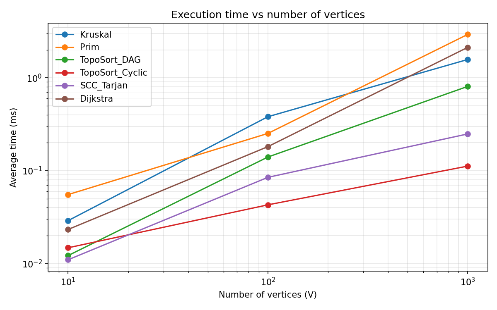
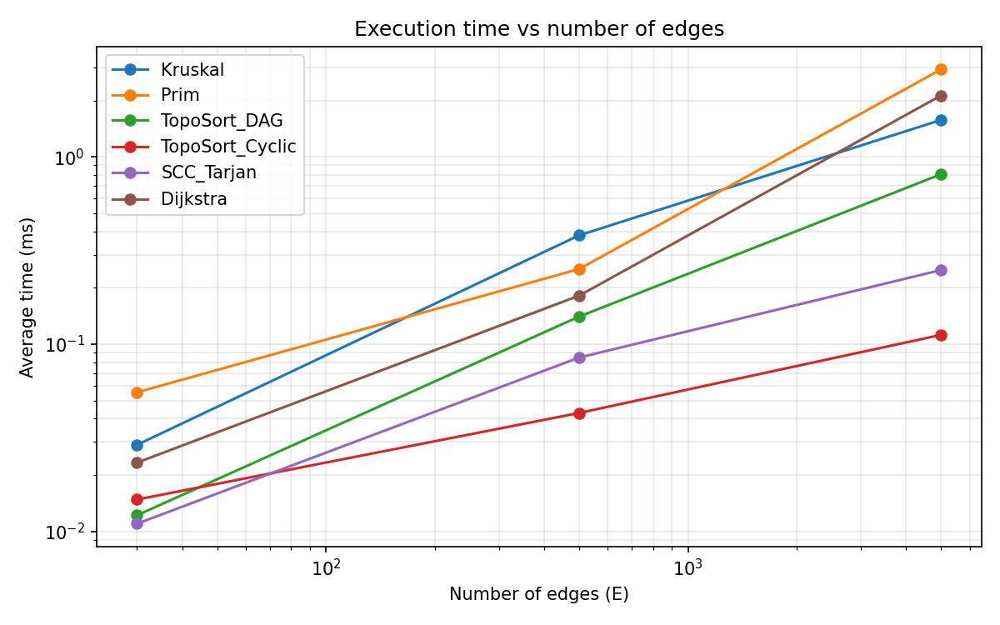
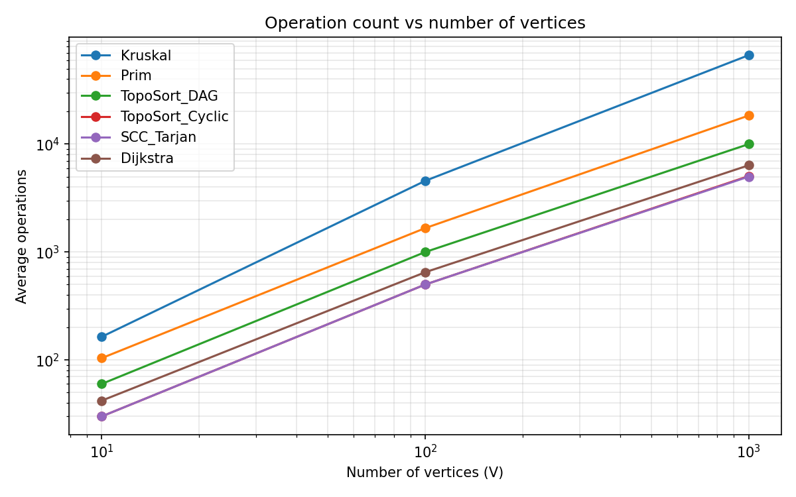
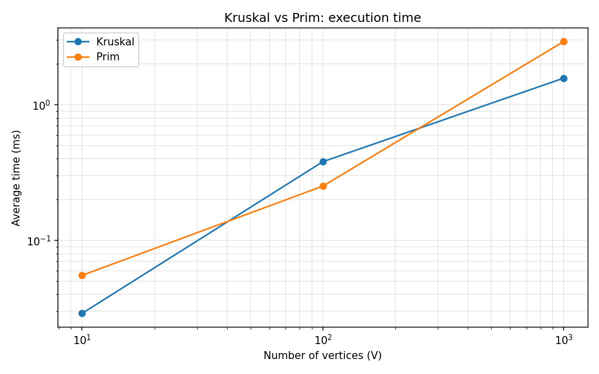
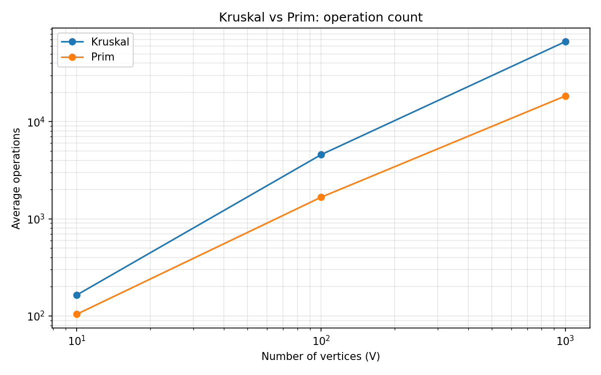

# Assignment 3: Smart City Infrastructure and Route Planning

Java project that models a smart city as a graph. It implements DSU, Kruskal's and Prim's MST algorithms, topological sort, Tarjan's SCC and Dijkstra's shortest paths, then measures them on graphs of three sizes.

Repository: https://github.com/ibrahimzh08-web/asik3daa

## Table of Contents

1. [Overview](#1-overview)
2. [Implementation](#2-implementation)
3. [Complexity Analysis](#3-complexity-analysis)
4. [Experimental Setup](#4-experimental-setup)
5. [Results](#5-results)
6. [Comparison and Discussion](#6-comparison-and-discussion)
7. [Testing](#7-testing)
8. [Conclusion](#8-conclusion)
9. [How to Run](#9-how-to-run)

---

## 1. Overview

A city is represented as a graph:

- **Vertices** are city districts or locations.
- **Edges** are roads or infrastructure connections.
- **Weights** are road construction costs (MST task) or travel distances (shortest path task). All weights are integers from 1 to 100.

The system supports three kinds of tasks:

| Task | Question | Algorithms |
|---|---|---|
| Infrastructure planning | What is the cheapest network that connects all districts? | Kruskal (with DSU), Prim |
| Connectivity analysis | Can services be ordered by dependencies? Which districts are mutually reachable on one-way roads? | Topological sort (Kahn), Tarjan SCC |
| Route planning | What is the shortest route from one district to all others? | Dijkstra |

### Graph representation

The graph is stored as an **adjacency list** (`List<List<Edge>>`) plus a separate list of all edges.

- `Edge` has `from`, `to` and `weight`.
- For an undirected graph, `addEdge(u, v, w)` stores the edge once in the edge list (used by Kruskal) and twice in the adjacency list, once in each direction (used by Prim and the other algorithms).
- For a directed graph the edge is stored once.

Adjacency list uses O(V + E) memory, which suits sparse graphs like the ones in this assignment (E = 3V to 5V).

### Project structure

```
asik3daa/
├── src/main/java/
│   ├── graph/          Edge, Graph, GraphGenerator
│   ├── dsu/            DSU
│   ├── mst/            MSTResult, Kruskal, Prim
│   ├── connectivity/   TopologicalSort, SCC
│   ├── shortestpath/   Dijkstra
│   └── experiments/    Main (quick check), Benchmark (experiments), Tests (correctness)
├── results/
│   ├── tables/         results.csv
│   └── plots/          PNG plots
├── pom.xml
└── README.md
```

---

## 2. Implementation

### Graph generation (`GraphGenerator`)

All generators take a seed, so every graph is reproducible. The experiments use seed **42**.

- **`connectedUndirected(n, m, seed)`**: first builds a random spanning tree (vertex `i` is connected to a random vertex `j < i`), which guarantees the graph is connected. Then it adds random edges until there are `m` edges. Self-loops and duplicate edges are rejected.
- **`directedDAG(n, m, seed)`**: edges are only allowed from a smaller index to a larger index (`u < v`). Such a graph cannot contain a cycle, so it is always a DAG.
- **`directedWithCycles(n, m, seed)`**: random directed edges without self-loops and without duplicates. Nothing prevents cycles, so the graph contains cycles. In the Small graph (V = 10, E = 30) with seed 42 the whole graph forms a single strongly connected component.

### DSU (`dsu.DSU`)

- `find(x)` uses **path compression**: every vertex on the path is attached directly to the root.
- `union(a, b)` uses **union by rank**: the root with the smaller rank is attached under the root with the larger rank.
- Counters `findCalls`, `unionCalls` and `pathSteps` record DSU operations for the experiments.

### Kruskal (`mst.Kruskal`)

1. Copy all edges and sort them by weight (comparisons are counted).
2. Go through edges in order. If `union(from, to)` succeeds (the endpoints were in different sets), add the edge to the MST.
3. Stop when the MST has `V - 1` edges.

The graph is connected if the result has exactly `V - 1` edges. For a disconnected graph Kruskal returns a minimum spanning forest and `connected = false`.

### Prim (`mst.Prim`)

Lazy version with `PriorityQueue<Edge>` (binary heap):

1. Start from vertex 0 and push all its edges.
2. Pop the cheapest edge. If its endpoint is already in the tree, skip it. Otherwise add the edge to the MST and push the new vertex's edges.
3. Stop when the heap is empty or the MST has `V - 1` edges.

For a disconnected graph Prim only covers the component of vertex 0, so `connected = false`.

### Topological sort (`connectivity.TopologicalSort`)

Kahn's algorithm: compute in-degrees, put all vertices with in-degree 0 in a queue, repeatedly remove a vertex and decrease the in-degree of its neighbors. If fewer than `V` vertices were output, the graph contains a cycle and the method returns `null`.

### SCC (`connectivity.SCC`)

Tarjan's algorithm: one DFS with `ids`, `low` values and a stack. When `low[u] == ids[u]`, vertex `u` is the root of a component and the stack is popped down to `u`. Every vertex belongs to exactly one component.

### Dijkstra (`shortestpath.Dijkstra`)

Binary heap (`PriorityQueue`) with lazy deletion: an outdated heap entry is skipped when its distance is greater than the current `dist`. Unreachable vertices keep distance `INF` (`Long.MAX_VALUE`) and `path()` returns an empty list for them. A negative weight throws `IllegalArgumentException`.

### Why Dijkstra does not work with negative edge weights

Dijkstra is greedy: when a vertex is taken from the heap, its distance is considered final. This is only correct if no later path can be shorter, which holds when all weights are non-negative (adding an edge never makes a path shorter).

With a negative edge this breaks. Example: edges `0 -> 1` (2), `0 -> 2` (3), `2 -> 1` (-2). Dijkstra takes vertex 1 first with distance 2 and never updates it. The real shortest distance is `3 + (-2) = 1` through vertex 2. For graphs with negative weights, Bellman-Ford should be used instead.

---

## 3. Complexity Analysis

Assumptions: graph stored as an adjacency list, priority queue is a binary heap, `V` is the number of vertices and `E` is the number of edges.

| Algorithm | Time | Space | Notes |
|---|---|---|---|
| DSU `find` | O(α(V)) amortized | O(V) | path compression + union by rank |
| DSU `union` | O(α(V)) amortized | O(V) | two `find` calls + O(1) linking |
| Kruskal | O(E log E) = O(E log V) | O(V + E) | sorting dominates |
| Prim (binary heap) | O(E log V) | O(V + E) | lazy version: up to O(E) entries in the heap |
| Topological sort (Kahn) | O(V + E) | O(V + E) | |
| SCC (Tarjan) | O(V + E) | O(V + E) | recursion depth up to V |
| Dijkstra (binary heap) | O((V + E) log V) | O(V + E) | O(E log V) when E ≥ V |

α is the inverse Ackermann function. It grows so slowly that α(V) ≤ 4 for any practical V, so DSU operations are almost O(1).

### How V and E affect performance

- **DSU**: the cost depends on the number of operations (about one `union` per processed edge in Kruskal) and almost not on V.
- **Kruskal**: dominated by sorting E edges, so E matters most. V only affects the DSU size. `log E ≤ 2 log V`, so O(E log E) and O(E log V) are the same class.
- **Prim**: each edge can be pushed into the heap and popped once, so E log V. In dense graphs (E close to V²) Prim with an array instead of a heap would be O(V²), which is better.
- **Topological sort and SCC**: each vertex and each edge is processed a constant number of times, so time grows linearly with V + E.
- **Dijkstra**: each edge can cause one heap insertion (O(log V)), so E log V dominates for graphs with E ≥ V.

---

## 4. Experimental Setup

### Graph sizes

| Graph | V | E |
|---|---|---|
| Small | 10 | 30 |
| Medium | 100 | 500 |
| Large | 1,000 | 5,000 |

### Graph generation

- Random generator `java.util.Random` with fixed seed **42**, so results are reproducible.
- **MST experiments** use a connected undirected graph (random spanning tree + random extra edges).
- **Topological sort** is tested on two directed graphs of each size: a **DAG** (edges only from smaller to larger index, so no cycles) and a **graph with cycles** (random directed edges, no restriction).
- **SCC** and **Dijkstra** run on the directed graph with cycles. Dijkstra starts from vertex 0.

### Measurement procedure

- Time: `System.nanoTime()` around one algorithm run, converted to milliseconds.
- Each experiment runs **3 warm-up runs** (not counted, so the JIT compiler can optimize the code) and then **5 measured runs**. The table shows the average of the 5 runs.
- Operation counts:
  - **Kruskal**: sort comparisons + DSU calls (`find` + `union`).
  - **Prim**: edge examinations + heap pushes + heap polls.
  - **Topological sort**: edge examinations (in-degree counting + queue processing).
  - **SCC**: edge examinations in DFS.
  - **Dijkstra**: heap polls + edge examinations.

Operation definitions differ between algorithms, so operation counts are comparable across graph sizes for the same algorithm, but only roughly comparable between different algorithms.

All raw data is in [`results/tables/results.csv`](results/tables/results.csv).

---

## 5. Results

### Execution time (ms, average of 5 runs)

| Algorithm | Small (V=10, E=30) | Medium (V=100, E=500) | Large (V=1000, E=5000) |
|---|---|---|---|
| Kruskal | 0.0290 | 0.3810 | 1.5731 |
| Prim | 0.0553 | 0.2518 | 2.9293 |
| Topological sort (DAG) | 0.0122 | 0.1403 | 0.8072 |
| Topological sort (graph with cycles) | 0.0148 | 0.0429 | 0.1120 |
| SCC (Tarjan) | 0.0110 | 0.0848 | 0.2486 |
| Dijkstra | 0.0233 | 0.1815 | 2.1247 |

### Operation counts (average of 5 runs)

| Algorithm | Small | Medium | Large |
|---|---|---|---|
| Kruskal (comparisons + DSU operations) | 164 | 4,567 | 66,675 |
| of which DSU operations (`find` + `union`) | 57 | 740 | 16,306 |
| Prim | 104 | 1,666 | 18,393 |
| Topological sort (DAG) | 60 | 1,000 | 10,000 |
| Topological sort (graph with cycles) | 30 | 500 | 5,054 |
| SCC (Tarjan) | 30 | 500 | 5,000 |
| Dijkstra | 42 | 650 | 6,366 |

### Plots

**Execution time vs number of vertices**



**Execution time vs number of edges**



**Operation count vs number of vertices**



**Kruskal vs Prim: execution time**



**Kruskal vs Prim: operation count**



All plots use logarithmic axes because the sizes grow by a factor of 10 per step. In our graphs E = 3V (Small) and E = 5V (Medium, Large), so V and E grow together and the two time plots have a similar shape.

---

## 6. Comparison and Discussion

### Kruskal vs Prim

Both algorithms returned the same MST weight on every connected graph we tested (the Small graph with seed 42 gives weight 129 for both, and the tests check 30 more random graphs).

- **Time**: Kruskal was faster on Small and Medium... except Prim was faster on Medium (0.2518 ms vs 0.3810 ms). On Large, Kruskal was faster (1.57 ms vs 2.93 ms). There is no stable winner at these sizes, and the times are in the range of fractions of a millisecond, where JIT compilation, garbage collection and timer noise matter a lot.
- **Operations**: Kruskal counts more operations (66,675 vs 18,393 on Large). Most of Kruskal's count comes from the **sorting comparisons** (66,675 - 16,306 = 50,369 comparisons), while the DSU part is only 16,306. Because the definitions of "operation" differ (a comparison is cheaper than a heap push or pop), Kruskal's higher count does not mean it is slower, and the time results confirm this.
- **Theory**: both are O(E log V), so similar behavior is expected. Prim's heap stores `Edge` objects and the undirected graph keeps every edge twice in the adjacency list, so it creates more heap work and more object overhead. This is a likely reason for Prim being slower on Large, but we did not profile it, so this is an interpretation and not a measured fact.

### DSU: effect of path compression and union by rank

- **Union by rank** keeps trees shallow: the smaller tree is always attached under the larger one, so the tree height stays O(log V).
- **Path compression** flattens the path during `find`, so later `find` calls on the same vertices are almost O(1).
- Together they give amortized O(α(V)) per operation. Without them, a chain of unions can create a long path and each `find` can cost O(V).
- In our experiment Kruskal made only 57, 740 and 16,306 DSU calls on Small, Medium and Large. The count grows in proportion to the number of processed edges, with no sign of a quadratic blow-up. We did not run a version without these optimizations, so the benefit is shown by the theory and by the low operation counts, not by a direct comparison.

### SCC: runtime growth

The operation count of Tarjan's algorithm is exactly E (30, 500, 5,000), because each edge is examined once, which matches O(V + E). Time grew from 0.0110 ms to 0.0848 ms to 0.2486 ms: E grew 167 times from Small to Large, but time grew only about 23 times. For very small inputs a fixed overhead (method calls, array allocation, timer resolution) dominates the real work, so time does not scale in a perfectly linear way at these sizes.

### Topological sort: DAG vs graph with cycles

- On a **DAG**, Kahn's algorithm processes all vertices and all edges: the operation count is exactly 2E (60, 1,000, 10,000): E edges for in-degree counting and E edges during queue processing.
- On a **graph with cycles**, the queue becomes empty early, because vertices that are on a cycle never reach in-degree 0. The algorithm stops after the in-degree pass plus a few edges (30, 500, 5,054 operations, close to E), returns `null` and reports the cycle. That is why it is also faster (0.1120 ms vs 0.8072 ms on Large).

### Dijkstra across graph sizes

Operations grew from 42 to 650 to 6,366 and time from 0.0233 ms to 0.1815 ms to 2.1247 ms. Time grows slightly faster than operations, which is expected from the extra `log V` factor of the heap in O(E log V): each heap operation is more expensive in a larger heap.

### Theory vs experiment

| Algorithm | Theory | Observed |
|---|---|---|
| Topological sort, SCC | O(V + E) | Operation counts are exactly proportional to E |
| Kruskal, Prim | O(E log V) | Counts and time grow a bit faster than linear in E |
| Dijkstra | O(E log V) | Time grows faster than operations |

Limits of the experiment: only three graph sizes, a single seed, sparse graphs, and very short running times. A larger study would use more seeds, bigger graphs and a benchmarking tool such as JMH.

---

## 7. Testing

`experiments.Tests` runs 21 checks. All 21 pass (`Passed: 21, Failed: 0`).

| Case | Check |
|---|---|
| Small graph (4 vertices) | Kruskal and Prim both return weight 6, graph reported as connected |
| Disconnected graph | Both Kruskal and Prim report `connected = false` |
| Multiple valid MSTs (triangle with equal weights) | Both return weight 2 |
| Duplicate edge weights | Both return weight 15 |
| Single vertex | MST weight 0 and connected; topological order `[0]`; one SCC; Dijkstra distance 0 |
| Random connected graphs (3 sizes x 10 seeds) | Kruskal weight equals Prim weight, both report connected |
| Random DAGs (3 sizes x 10 seeds) | Topological order is valid: every edge goes from an earlier to a later vertex, and all vertices are present |
| Graph with a cycle | Topological sort returns `null`; SCC returns one component of size 3 |
| SCC on generated cyclic graphs | Every vertex belongs to exactly one component |
| SCC on a DAG | Every vertex is its own component (10 components) |
| Dijkstra on a small directed graph | Distances 0, 3, 1, 4 and path `[0, 2, 1, 3]` |
| Unreachable vertex | Distance is `INF` and the path is empty |
| Negative edge weight | Dijkstra throws `IllegalArgumentException` |

---

## 8. Conclusion

- **DSU** with path compression and union by rank gives almost constant time per operation and is the key part of Kruskal's algorithm.
- **Kruskal** is a good choice for sparse graphs and when the edges are already given as a list. **Prim** is a good choice when the graph is already an adjacency list or is dense. In our tests both gave the same MST weight, and neither was clearly faster at these sizes.
- **Topological sort** (Kahn) is the right tool for ordering dependencies between infrastructure services, and it also detects cycles. **Tarjan's SCC** finds groups of districts that can reach each other on one-way roads. Both run in O(V + E).
- **Dijkstra** is the right tool for shortest routes when all weights are non-negative. With negative weights Bellman-Ford is needed.
- The experiments confirmed the expected growth: linear for topological sort and SCC, and slightly faster than linear for the heap-based algorithms (Kruskal, Prim, Dijkstra).

---

## 9. How to Run

Requirements: JDK (the project was built with JDK 25) and Maven, or IntelliJ IDEA.

In IntelliJ IDEA, open the project and run the `main` method of:

- `experiments.Main`: quick check on a Small graph;
- `experiments.Tests`: correctness tests;
- `experiments.Benchmark`: experiments, writes `results/tables/results.csv`.

Operation counts are deterministic (same seed, same result). Execution times depend on the machine, so they will differ slightly on another computer.
